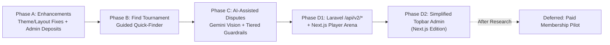
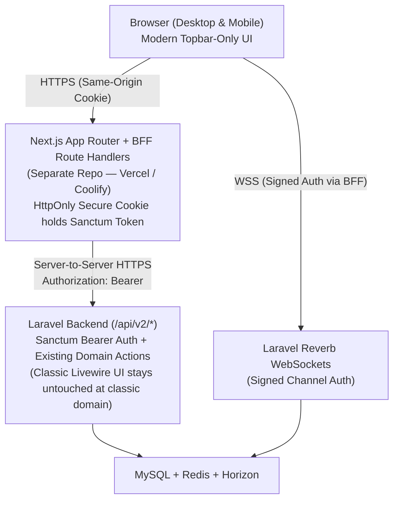

# GamersRival (PlayerSaloons) — Detailed Implementation Plan

Date: 2026-11-26  
Status: **Approved Architecture & Blueprint (Ready for Phased Execution)**  
Related Docs:
- `documentation/roadmap-and-enhancements-checklist.md` (High-level tracking checklist)
- `documentation/new-requirements-2026-11.md` (Original requirements & deferred Membership spec)
- `AGENTS.md` (Repository architecture, coding standards, testing & CI guidelines)

---

## 0. Executive Summary & Delivery Order

This document provides the complete technical blueprint for the next four delivery phases of GamersRival while preserving existing tournament, wallet, escrow, PlayStrategy, and Google OAuth workflows.



### Non-Negotiable Codebase Invariants (All Phases)
1. **Domain isolation:** Business logic lives in `app/Modules/{Domain}/Actions/` and `Services/`; persistence in `Models/`; async work in `Jobs/` and `Listeners/`.
2. **Action-level authorization:** Every Action enforces its own authorization/permissions (never rely solely on route middleware or UI visibility).
3. **Financial & match safety:** All balance changes go through `WalletService`/ledger; match transitions go through `MatchStateMachine`; transactions preserve lock ordering (`Tournament → GameMatch → MatchAttempt / MatchDispute / ExternalMatchGame`).
4. **No global query scopes for catalog inactivity:** Continue using opt-in `Game::scopeAvailableInCatalog()` so background jobs, payouts, disputes, and admin screens are never broken.
5. **Localization & quality gates:** All user-facing copy belongs in `lang/en.json`; every phase must pass focused PHPUnit tests, `./vendor/bin/pint --test`, `./vendor/bin/phpstan analyse`, and `npm run build`.

---

## 1. Phase A — Enhancements (Classic UI Polish & Admin Deposits)

### 1.1 Light Mode, Dark Mode & Desktop Responsive Layout Audit

#### Problem Statement
- In **Light Mode** (`html[data-theme='light']`), several text labels, secondary badges, and Lucide icons inherit low-contrast zinc/slate utilities and become invisible or barely readable.
- In **Dark Mode**, select muted captions, borders, and button states lose contrast against dark card surfaces.
- On **Desktop & Tablet (`>= 768px`)**, long game titles, tournament names, badges, and homepage card layouts occasionally overflow or clip outside card boundaries *(mobile `< 768px` is currently working well and must not regress)*.

#### Target Files to Audit & Fix
- `resources/css/app.css` (Light theme overrides `html[data-theme='light'] .theme-player` & `.theme-admin`, card overflow guards)
- `resources/css/guest-v4.css` & `resources/css/guest.css` (Homepage hero, game cards, featured tournament cards, auth pages)
- `resources/views/livewire/landing/landing-page.blade.php`
- `resources/views/components/guest/table-card.blade.php`
- `resources/views/livewire/tournament/player-tournament-list.blade.php`
- `resources/views/livewire/dashboard/player-dashboard.blade.php`
- `resources/views/livewire/match/match-detail.blade.php`
- `resources/views/livewire/profile/profile-dashboard.blade.php`

#### Technical Fix Standards
1. **Contrast floor (WCAG AA):**
   - Body & primary labels: `>= 4.5:1` contrast ratio in BOTH dark and light themes.
   - Secondary metadata, badges, and interactive icons: `>= 3:1` (minimum) / `4.5:1` for small text (`11px–13px`).
   - Explicit icon color rules in `html[data-theme='light']` so SVG/Lucide strokes never remain `#ffffff` or `#e4e4e7` on `#f8fbff` / `#edf4fc` light surfaces.
2. **Overflow & Flex/Grid Containment (Desktop & Tablet):**
   - Apply `min-w-0` on every flex/grid child holding dynamic text (tournament names, usernames, emails, game titles).
   - Apply `overflow-hidden`, `break-words` / `line-clamp-2` (for multi-line card titles) or `truncate` (for single-line handles/emails) consistently across homepage & tournament cards.
   - Ensure card grids use `minmax(0, 1fr)` instead of bare `1fr` so long unbroken strings cannot blow out column widths.
   - Verify zero horizontal scrollbar (`document.documentElement.scrollWidth <= window.innerWidth`) at `1440px`, `1280px`, `1024px`, `768px`, and `390px`.

#### Verification Checklist (Phase A.1)
- [ ] Inspect Homepage (`/`), Public Tournaments (`/tournaments`), Player Dashboard (`/dashboard`), Browse Tournaments (`/tournaments/browse`), Match Room (`/matches/{uuid}`), and Profile (`/profile`) in **both Dark and Light themes** at `1440px`, `1024px`, `768px`, and `390px`.
- [ ] Confirm mobile layout (`390px`) has zero regressions.
- [ ] Run `npm run build` and existing CMS/Dashboard/Landing Livewire feature tests.

---

### 1.2 Admin Deposits History Page (`/admin/deposits`)

#### Objective
Give authorized Finance/Admin staff a dedicated, read-only audit page listing **every player deposit** across all payment gateways (Stripe, Payop, etc.) with search, filtering, KPI summaries, and transaction detail inspection—without mutating wallet/ledger behavior.

#### Existing Data Model (Verified in Codebase)
- `deposits` table (`App\Modules\Wallet\Models\Deposit`):
  - `id`, `uuid`, `wallet_id` (FK → `wallets.id` → `users.id`), `amount` (`decimal(18,2)`), `fee_amount` (`decimal(18,2)`), `provider` (`stripe`, `payop`, etc.), `provider_reference`, `status` (`pending`, `completed`, `failed`, `refunded`, etc.), `created_at`, `updated_at`.
- `payment_checkouts` table (`App\Modules\Wallet\Models\PaymentCheckout`):
  - Linked checkout telemetry (`amount`, `fee_amount`, `total`, `gateway_configuration_id`, `completed_at`) for cross-referencing gateway details when present.
- `ledger_entries` table (`App\Modules\Wallet\Models\LedgerEntry`):
  - Authoritative credit audit trail (`type = 'deposit'`, `reference_type`, `reference_id`).

#### Files to Create / Update
1. **Database Index Migration:** `database/migrations/2026_11_26_000001_add_deposits_filter_index.php`
   - Adds composite index `deposits_status_provider_created_idx` on `deposits (status, provider, created_at)` so filtered history and KPI aggregations stay fast as deposit volume grows.
2. **Livewire Component:** `app/Livewire/Admin/DepositAdmin.php` (extends `AdminComponent`)
   - **Authorization (`boot()`):** Enforce existing `deposits.view` permission (`abort_unless($this->actor()->can('deposits.view'), 403);`), already assigned to `SUPER_ADMIN`, `ADMIN`, `FINANCE_OPERATOR`, and `SUPPORT_AGENT` in `RolesAndPermissionsSeeder`.
   - **Filters (URL-synced via `#[Url]`):**
     - `search`: matches player username, player email, deposit `uuid`, or `provider_reference`.
     - `statusFilter`: `all`, `completed`, `pending`, `failed`, `cancelled`, `expired`.
     - `providerFilter`: `all`, `stripe`, `payop` (dynamically populated from distinct providers + known gateways).
     - `dateFrom` / `dateTo`: `created_at` date range filter (defaults to last 30 days on initial mount to bound query cost; user can clear or widen at any time).
   - **KPI Summary Strip (exact verified accounting via integer minor units / SQL aggregates):**
     - Verified against `ProcessDepositAction`, `StripeWebhookController`, `SyncPayopDepositAction`, and `EscrowCashflowAdmin`: `deposits.amount` is ALREADY the **Net Credited** amount added to the player wallet, and `deposits.fee_amount` is the **Processing Fee** charged on top.
     - **Completed Deposits:** count of `completed` rows matching current filters.
     - **Gross Charged:** `SUM(amount) + SUM(fee_amount)` (computed via `DecimalMoney::toMinor()` / SQL sums — NEVER `amount - fee_amount`).
     - **Processing Fees Collected:** `SUM(fee_amount)`.
     - **Net Credited to Wallets:** `SUM(amount)`.
     - **Pending / Failed Count:** count of non-completed deposits matching current filters.
   - **Detail Modal (`selectDeposit(int $id)`):**
     - Shows full deposit UUID, player username/email (`Wallet::user()` uses `withTrashed()`), wallet UUID, provider & reference ID, gross/fee/net breakdown, matching `LedgerEntry` record (`reference_type = Deposit::class`), matching `PaymentCheckout` record (if present), and timestamps.
   - **Pagination:** 20 rows per page (`WithPagination`), eager-loading `wallet.user` to avoid N+1 queries.
3. **Blade View:** `resources/views/livewire/admin/deposit-admin.blade.php`
   - Clean, responsive table matching `WithdrawalAdmin` & `EscrowCashflowAdmin` visual system (both Dark & Light admin theme compatible).
4. **Route:** `routes/web.php` inside `Route::middleware(['auth', 'role.admin'])->prefix('admin')`:
   - `Route::get('/deposits', DepositAdmin::class)->name('admin.deposits');`
5. **Admin Navigation:** Add **Deposits** nav item right next to **Withdrawals** in `resources/views/components/layouts/admin.blade.php` (`'permission' => 'deposits.view'`), automatically updating both desktop sidebar and mobile drawer.
6. **Translations:** Add all labels/empty states to `lang/en.json`.

#### Verification Checklist (Phase A.2)
- [ ] New feature test `tests/Feature/Admin/DepositAdminTest.php`:
  - Unauthorized users / regular players get `403`.
  - Authorized admin/finance operator sees deposit history and accurate KPI totals.
  - Search by username, email, UUID, and `provider_reference` works accurately.
  - Filtering by `status`, `provider`, and date range narrows rows and totals accurately.
  - Detail modal opens cleanly and handles soft-deleted users (`withTrashed()`) without crashing.

---

## 2. Phase B — Find Tournament (Guided Quick-Finder)

### Architectural Overview
A fast, guided **Quick-Finder modal/bar** that lets both guests and logged-in players specify what they want to play and immediately surfaces the best open tournaments with **1-click Join**—backed by a reusable domain service (`FindActiveTournamentsService`) that will later also power `/api/v2/tournaments/find` in the Next.js SPA.

### Agreed UX & Functional Specification
1. **Entry Points (3 placements):**
   - **Homepage Hero** (`resources/views/livewire/landing/landing-page.blade.php`): prominent `Find Tournament` CTA button.
   - **Player Dashboard** (`resources/views/livewire/dashboard/player-dashboard.blade.php`): quick-action card/CTA.
   - **Topbar Navigation** (Guest header & Player app header): crisp `Find Tournament` trigger button.
2. **Guided Inputs:**
   - **Category** (`All`, `Video Games`, `Card & Board Games`, or any active category)
   - **Game** (filtered dynamically by selected Category; only `availableInCatalog()` games)
   - **Platform** (filtered dynamically to platforms supported by the selected Game, or all active platforms)
   - **Entry Fee / Budget** (`Any`, `Free Only`, `Up to €5`, `Up to €20`, `High Stakes €20+` — currency-aware via `Currency::symbol()`)
   - **Time Window** (`Anytime`, `Starting Soon (< 2h)`, `Today`, `This Week`)
   - **Competition Mode** (`All`, `Tournaments`, `1v1 Head-to-Head`)
3. **Ranking & Result Behavior:**
   - Only returns **active, registration-open** tournaments (`REGISTRATION_OPEN`, `start_at > now()`, `join_closes_at > now()` if V2, seats available, active game & active category).
   - **Ranking order:**
     1. Filling fast (highest fill percentage with seats still open)
     2. Soonest `start_at`
     3. Featured flag tie-breaker
   - **Zero Exact Matches Fallback:**
     - Automatically runs a relaxed fallback query (preserving selected Game first, else selected Category, else any open event) and displays a clear banner: *"No exact matches for your filters — here are the closest open tournaments."*
   - **1-Click Action per Result Row:**
     - **Guest:** `View & Join →` (links to `/tournaments/{uuid}/view`, preserving intended redirect after login).
     - **Logged-in Player (non-PlayStrategy):** `Join Now →` opens tournament detail/join modal directly.
     - **Logged-in Player (PlayStrategy game):** Shows PlayStrategy badge; if account already linked, direct `Join Now →`; if not linked, clear inline prompt to link PlayStrategy in `/profile`.

### Files to Create / Update
1. **Database Index Migration:** Add composite index on `tournaments (status, start_at, game_id)` so active registration-open discovery stays indexed under load.
2. **Domain Service:** `app/Modules/Tournament/Services/FindActiveTournamentsService.php`
   - Method: `find(array $criteria, int $limit = 8): array{exact: bool, fallback_reason: ?string, tournaments: Collection<int, Tournament>, total_matching: int}`
   - Supports both Legacy and V2 (`config('features.tournament_v2.enabled')`), strictly applying `Game::scopeAvailableInCatalog()`.
   - Cache active categories, catalog games, and platforms in Redis for 60s (invalidated on admin save) so modal opens stay lightweight.
   - Reused later by `/api/v2/tournaments/find` (zero duplicated query logic!).
3. **Livewire Component:** `app/Livewire/Tournament/FindTournamentModal.php` + `resources/views/livewire/tournament/find-tournament-modal.blade.php`
   - **Strictly lazy:** When closed (`$open === false`), `render()` executes **zero** DB queries. Hydrates filter options and matches only when `@open-find-tournament.window` opens it.
   - Debounced live updates, keyboard `Escape` close, focus trap, mobile full-screen sheet, Dark & Light theme support.
4. **Layout & Page Triggers:**
   - Mount `<livewire:tournament.find-tournament-modal />` cleanly in Guest & Player layouts.
   - Add `Find Tournament` trigger buttons to Homepage Hero, Player Dashboard, and Topbar.
5. **Translations:** Add all strings to `lang/en.json`.

### Verification Checklist (Phase B)
- [ ] New feature test `tests/Feature/Tournament/FindTournamentTest.php`:
  - Exact matching by Category, Game, Platform, Free/Entry-Fee range, and Time Window.
  - Fallback results returned with `exact === false` when 0 exact matches exist.
  - Inactive categories, disabled/soft-deleted games, full tournaments, and elapsed/closed occurrences are NEVER returned in exact OR fallback results.
  - Modal renders cleanly for guests and authenticated players and links accurately to matching tournaments.

---

## 3. Phase C — AI-Assisted Dispute Management

### Architectural Overview
Integrate a **multimodal Vision AI analyzer** (defaulting to **Google Gemini** behind a swappable interface) into the existing dispute pipeline so admins receive instant structured evidence analysis and—once validated in Shadow Mode—eligible low-risk disputes can auto-resolve at `>= 95%` confidence under strict financial & fairness guardrails.

```mermaid
sequenceDiagram
    participant P1 as Player A
    participant P2 as Player B
    participant App as SubmitEvidenceAction
    participant Q as Queue (Horizon)
    participant AI as GeminiDisputeAnalyzer
    participant Gate as EvaluateAiDisputeAutoResolveAction
    participant Admin as Admin Dispute Modal

    P1->>App: Upload screenshot #1
    App->>Q: Dispatch AnalyzeDisputeWithAiJob (afterCommit)
    App->>Q: Dispatch EvaluateAiDisputeAutoResolveJob (delayed by response window)
    Q->>AI: Analyze screenshot #1 + match metadata + PlayStrategy logs
    AI-->>Q: Structured JSON (suggested_resolution, confidence, reasoning, red_flags)
    Q->>Admin: Save DisputeAiAnalysis (Advisory visible immediately; NO auto-resolve yet!)

    opt Player B uploads before window expires
        P2->>App: Upload screenshot #2
        App->>Q: Dispatch AnalyzeDisputeWithAiJob (re-run with BOTH screenshots!)
        Q->>AI: Re-analyze with both screenshots & claims
        AI-->>Q: Updated DisputeAiAnalysis (version 2)
        Q->>Gate: Trigger auto-resolve eligibility check immediately
    end

    Note over Gate: Auto-Resolve Guardrails Check
    alt Shadow Mode OR Confidence < 95% OR Prize > Cap OR Final OR Red Flags/Strike
        Gate->>Admin: Keep UNDER_REVIEW for human Admin decision
    else Live Auto-Resolve Enabled AND All Guardrails Pass
        Gate->>Admin: Atomically resolve dispute via ResolveDisputeByAiAction (resolved_by = null) + Audit Log
    end
```

### Database Schema (`database/migrations/2026_11_26_000001_create_dispute_ai_analyses_table.php`)
Table: `dispute_ai_analyses`
- `id` (bigIncrements)
- `uuid` (uuid, unique)
- `match_dispute_id` (FK → `match_disputes.id`, cascadeOnDelete, indexed)
- `analysis_version` (unsignedSmallInteger — `1` after first upload, `2` after second upload, etc.)
- `evidence_count` (unsignedTinyInteger — how many evidence rows were included)
- `provider` (string 40 — e.g. `gemini`, `openai`)
- `model` (string 80 — e.g. `gemini-2.5-flash`)
- `status` (string 30 — `pending`, `completed`, `failed`)
- `suggested_resolution` (string 30, nullable — `player_a`, `player_b`, `rematch`, `needs_human_review`)
- `confidence` (decimal 5,4, nullable — `0.0000` to `1.0000`)
- `summary` (text, nullable — plain-English explanation for admin)
- `evidence_findings_json` (json, nullable — per-player extracted score/username/timestamp checks)
- `red_flags_json` (json, nullable — e.g. cropped scoreboard, mismatched username, suspected edit, blurry image, conflicting claims)
- `prompt_hash` (string 64, nullable)
- `raw_response_json` (json, nullable — sanitized structured response for auditability)
- `auto_resolve_eligible` (boolean, default `false`)
- `auto_resolve_blocked_reason` (string 191, nullable — exact guardrail that blocked auto-resolve)
- `auto_resolved_at` (timestamp, nullable)
- `error_message` (text, nullable)
- `created_at`, `updated_at`
- Unique index: `(match_dispute_id, analysis_version)`

### Pre-Implementation Infrastructure Prerequisite (Dispute Evidence Storage)
> **Critical Finding from Codebase Audit:** `SubmitEvidenceAction` currently writes dispute screenshots to the `public` disk (`storage/app/public/evidence/`), and `docker-compose.prod.yml` mounts `storage_data` only on `app`, NOT on the `worker` container.
> Before `AnalyzeDisputeWithAiJob` runs in Phase C:
> 1. Move dispute evidence uploads to a **shared private disk** (e.g., `local`/S3 private bucket) with an authorized signed preview controller (mirroring `KycDocumentController`) so player screenshots are no longer publicly enumerable.
> 2. Mount the shared `storage_data` volume (or shared S3 disk) on the `worker` container in `docker-compose.prod.yml` so queued Horizon jobs can actually read uploaded screenshots in production.

### AI Provider Implementation (Lean Cut)
1. **DTOs:**
   - `app/Modules/Match/Data/DisputeAnalysisContext.php` (match info, game name, player A/B usernames & game IDs, result submissions, PlayStrategy payload if any, dispute reason, resized base64/MIME evidence images).
   - `app/Modules/Match/Data/DisputeAnalysisResult.php` (provider, model, `suggestedResolution`, `confidence`, `summary`, `evidenceFindings`, `redFlags`, `rawResponse`).
2. **Concrete Implementation:** `app/Modules/Match/Services/GeminiDisputeAnalyzer.php`
   - Start with the concrete Gemini service directly (introduce an interface only if/when a second Vision provider is actually added).
   - Calls Google Gemini `generateContent` REST endpoint via Laravel `Http::` (no heavy third-party SDK needed; 100% testable via `Http::fake()`).
   - **Image Cost/Payload Cap:** Downscale/re-encode uploaded screenshots to max `1024px` (JPEG/WebP) before base64 encoding so large 4K phone screenshots do not blow up Horizon worker RAM or Gemini token costs.
   - Uses `responseMimeType: "application/json"` + strict `responseSchema` so output is deterministic JSON.
   - **Prompt-Injection Hardening:** System instruction explicitly treats player dispute reasons and text inside screenshots as **untrusted user input**; instructs the model to ignore any instructions embedded inside screenshots/text and flag them under `red_flags` (`prompt_injection_suspected`), forcing `suggested_resolution = 'needs_human_review'` and `confidence <= 0.50`.
3. **Configuration (`config/services.php` & `SystemSetting`):**
   - Env vars in `.env.example`:
     - `AI_DISPUTE_PROVIDER=gemini`
     - `GEMINI_API_KEY=`
     - `GEMINI_DISPUTE_MODEL=gemini-2.5-flash`
   - Admin-editable `SystemSetting` keys (in `SystemSettingsAdmin`):
     - `ai.disputes.enabled` (`false` by default until API key configured)
     - `ai.disputes.mode` (`shadow` by default; `auto_resolve` when admin enables live auto-resolution)
     - `ai.disputes.min_confidence` (`0.95`)
     - `ai.disputes.max_prize_cap` (`50.00` — expressed in the platform's locked `Currency::code()`, never hardcoded to EUR/USD)
     - `ai.disputes.evidence_window_minutes` (`10`)
     - `ai.disputes.max_runs_per_dispute` (`3` — hard cap on automated/manual AI runs per dispute to prevent spam)

### Exact Auto-Resolve Guardrails (`EvaluateAiDisputeAutoResolveAction` + `ResolveDisputeByAiAction`)
Auto-resolution **ONLY** executes inside a transaction (locking `Tournament → GameMatch → MatchDispute`) when **EVERY** condition below holds:
1. `ai.disputes.enabled === true` AND `ai.disputes.mode === 'auto_resolve'` (Shadow Mode NEVER mutates match state).
2. `MatchDispute` is still `OPEN` or `UNDER_REVIEW` and `GameMatch` is still `DISPUTED`.
3. **Concurrency & Freshness Guard (under `MatchDispute` row lock):** Re-query `MatchEvidence::where('match_dispute_id', ...)->count()` and assert it equals `$latestAnalysis->evidence_count`, AND assert there is NO `pending` `DisputeAiAnalysis` row for this dispute (prevents stale 1st-evidence auto-resolve racing against a 2nd upload in flight).
4. **Fairness Wait Rule:** EITHER `evidence_count >= 2` (both participants uploaded evidence) **OR** `now()->greaterThanOrEqualTo($firstEvidenceAt->addMinutes($windowMinutes))` (opponent missed the response window).
5. `suggested_resolution` is strictly `player_a` or `player_b` (never `needs_human_review`).
6. `confidence >= min_confidence` (default `0.95`).
7. `red_flags_json` is **empty** (`[]`).
8. **Financial Cap:** Tournament `prize_pool <= max_prize_cap` AND `entry_fee <= max_prize_cap` (in the platform's locked `Currency::code()`, configurable, default `50.00`).
9. **Finals Protection:** Match is **NOT** the tournament final (check `round_number < max_round_number` / next-round match exists; 2-player single-match tournaments are treated as finals unless explicitly allowed by setting—default: finals require human admin review!).
10. **Dedicated System Action (`ResolveDisputeByAiAction`) & No Auto-Strikes:** Do **NOT** call `ResolveDisputeAction` (which enforces `ADMIN`/`SUPER_ADMIN` user roles and hardcodes `resolution_reason = 'admin_resolution'`). Instead, invoke a dedicated `ResolveDisputeByAiAction` that verifies all guardrails under lock, sets `resolved_by = null`, `resolution_reason = 'ai_auto_resolution'`, transitions the match via `MatchStateMachine`, dispatches `MatchCompleted`, and logs a full audit entry (`ai_analysis_id`, `confidence`, `model`). **It NEVER invokes `IssueDisputeStrikeAction` or `ApplyComplianceBlockAction`** (dishonesty penalties remain strictly human Admin actions).

> **Note on PlayStrategy Disputes:** If a PlayStrategy match was escalated due to `aborted` (0 moves), AI still summarizes the evidence/screenshots for the admin, and if PlayStrategy returned no official winner, `red_flags` notes `provider_aborted_no_winner` so human admin review remains primary unless overridden by policy.

### Admin UI Integration (`MatchAdmin.php` + `match-admin.blade.php`)
- Inside the Admin Dispute Modal:
  - **AI Assistant Panel:** Shows status (`Analyzing…`, `Advisory Ready`, `Auto-Resolved`, or `Analysis Unavailable`), Confidence Badge (e.g. `96% Confidence`), Suggested Ruling (`Player A` / `Player B` / `Rematch` / `Needs Human Review`), bulleted Evidence Findings, and highlighted Red Flags.
  - **Admin Action Buttons:** `"Re-run AI Analysis"` button + existing `"Award Player A"`, `"Award Player B"`, `"Issue Rematch"` controls (admin always retains final override authority).
  - **Shadow Mode Accuracy Metric:** When admin resolves a dispute that had an AI analysis, record whether admin agreed with AI (`admin_agreed` boolean) so the team can verify real-world accuracy before switching from `shadow` to `auto_resolve`!

### Verification Checklist (Phase C)
- [ ] New feature test `tests/Feature/Match/AiDisputeManagementTest.php` (using `Http::fake()` against Gemini endpoint):
  - Uploading 1st screenshot dispatches `AnalyzeDisputeWithAiJob` after commit and stores `analysis_version = 1`.
  - Uploading 2nd screenshot triggers re-analysis (`analysis_version = 2`) with both images.
  - **Shadow Mode:** Even at `0.99` confidence with both screenshots, match stays `DISPUTED` (advisory only).
  - **1st-Upload Wait Guard:** In `auto_resolve` mode, `0.99` confidence on 1st upload does NOT resolve before response window expires; resolves cleanly once 2nd player uploads OR window expires.
  - **Prize Cap Guard:** Blocks auto-resolve when prize pool exceeds `max_prize_cap` and logs `auto_resolve_blocked_reason`.
  - **Finals Guard:** Blocks auto-resolve on tournament final matches.
  - **Red Flags Guard:** Blocks auto-resolve whenever `red_flags_json` is non-empty (e.g. suspected edit or prompt injection).
  - **No Auto-Strike:** Confirms `PlayerDisputeStrike` count remains `0` after AI auto-resolution.
  - **API Outage Safety:** Gemini HTTP 500/timeout marks analysis `failed` cleanly without blocking manual Admin dispute resolution.

---

## 4. Phase D — Simplified GamersRival UI (Separate Next.js Repo + Laravel `/api/v2/*`)

### Architectural Overview
Build a clean, modern, low-complexity **Next.js App Router** frontend in a **separate Git repository** (deployed independently on Coolify/Vercel) while keeping the existing Laravel + Livewire application **100% untouched** as the **"Classic"** version.



### 4.1 Security & Authentication Architecture (Next.js BFF + Laravel Sanctum)
1. **Zero Tokens in `localStorage`:**
   - Next.js login/register Route Handlers (`app/api/auth/*`) call Laravel `POST /api/v2/auth/login` or `/register`, receive the Sanctum Personal Access Token (`token`), and store it inside an **`HttpOnly`, `Secure`, `SameSite=Lax`** cookie scoped to the Next.js domain.
   - All client mutations/fetches either run in Next.js Server Components or proxy through Next.js Route Handlers (`/api/proxy/*`), which read the `HttpOnly` cookie server-side and attach `Authorization: Bearer <token>` to Laravel `/api/v2/*`.
2. **Google OAuth One-Time Code Exchange:**
   - User clicks `Continue with Google` on Next.js → navigates to Laravel `GET /auth/google/redirect?client=modern`.
   - Laravel completes Google PKCE OAuth, verifies user/status/2FA:
     - **Existing active player (no 2FA):** Laravel stores a **60-second single-use random code** in Redis (`oauth_exchange:{hash}` → `user_id`), redirects back to `{MODERN_APP_URL}/auth/google/callback?code={oneTimeCode}`.
     - Next.js Route Handler exchanges `code` server-to-server via `POST /api/v2/auth/google/exchange` → receives Sanctum Bearer token → sets `HttpOnly` cookie → redirects to `/dashboard`!
     - **New user:** Redirects to Next.js `/auth/google/complete?setup_token={shortLivedToken}` → Next.js submits username, legal name, country, and 18+/policy consent to `POST /api/v2/auth/google/complete` → receives Sanctum token!
     - **2FA required:** Redirects to Next.js `/two-factor-challenge?challenge_token={shortLivedToken}` → exchanges 6-digit TOTP code at `POST /api/v2/auth/two-factor` for Sanctum token!
3. **Token Lifecycle, Middleware Hardening & Logout:**
   - **Sanctum Expiration:** Update `config/sanctum.php` (`'expiration' => env('SANCTUM_TOKEN_EXPIRATION_MINUTES', 10080)`) — currently `null` (tokens never expire).
   - **API Account & Compliance Guards:** Attach `EnsureAccountIsActive` and `compliance.clear` middleware to authenticated `/api/v2/*` routes (currently only on `web`), AND revoke all Sanctum tokens (`$user->tokens()->delete()`) inside `SuspendUserAction` and `ChangeUserStatusAction` on suspend/ban.
   - `POST /api/v2/auth/logout` revokes the current Sanctum token on Laravel AND clears the `HttpOnly` cookie in Next.js.
4. **Realtime (Reverb):**
   - Next.js exposes `/api/broadcasting/auth` which forwards the user's Bearer token to Laravel `/api/v2/broadcasting/auth` so private match/notification channels stay 100% authenticated.
5. **Architecture & Maintenance Trade-Off Note (Before Starting Phase D):**
   - Running a separate Next.js repo + `/api/v2/*` API adds a second deployable, BFF auth proxy, and schema sync overhead. Before starting Phase D, confirm whether a standalone Next.js repo is still required (e.g. separate public/marketing hosting or future mobile app consuming `/api/v2/*`) vs. **Inertia.js + React** inside the Laravel repo (same React UI, zero `/api/v2/*` boilerplate, native Laravel session + Google OAuth + CSRF).
   - If proceeding with standalone Next.js + `/api/v2/*`: generate TypeScript types from an OpenAPI spec (e.g. Scramble) so response shapes never drift, and deprecate overlapping `/api/v1/*` endpoints once migrated.

### 4.2 Laravel `/api/v2/*` Endpoint Catalog (Zero Duplicated Business Logic)
Every controller under `app/Http/Controllers/Api/V2/` is a thin adapter that validates input, authorizes via Policies/Actions, invokes existing Domain Actions, and returns consistent Laravel API Resources (`app/Http/Resources/V2/*`).

#### Sub-Phase D1 — Core Player Arena Endpoints
| Domain | Endpoints | Underlying Existing Action / Service |
|---|---|---|
| **Auth** | `POST /api/v2/auth/login`, `POST /api/v2/auth/register`, `POST /api/v2/auth/two-factor`, `POST /api/v2/auth/google/exchange`, `POST /api/v2/auth/google/complete`, `POST /api/v2/auth/logout`, `GET /api/v2/auth/me`, `POST /api/v2/broadcasting/auth` | `RegisterUserAction`, `GoogleOAuthClient`, `CountryEligibilityService`, Sanctum |
| **Catalog & Discovery** | `GET /api/v2/categories`, `GET /api/v2/games`, `GET /api/v2/tournaments`, `GET /api/v2/tournaments/find`, `GET /api/v2/tournaments/{uuid}` | `Game::availableInCatalog()`, `V2TournamentDiscoveryService`, `FindActiveTournamentsService` |
| **Participation** | `POST /api/v2/tournaments/{uuid}/register`, `POST /api/v2/tournaments/{uuid}/cancel`, `GET /api/v2/my-tournaments` | `RegisterForV2TournamentAction`, `RegisterForTournamentAction`, `CancelRegistrationAction`, `RequestV2CancellationAction` |
| **Match Room & PlayStrategy** | `GET /api/v2/matches/{uuid}`, `POST /api/v2/matches/{uuid}/result`, `POST /api/v2/matches/{uuid}/confirm`, `POST /api/v2/matches/{uuid}/dispute`, `POST /api/v2/matches/{uuid}/evidence`, `POST /api/v2/matches/{uuid}/playstrategy/poll` | `SubmitV2MatchResultAction`, `SubmitMatchResultAction`, `ConfirmMatchResultAction`, `OpenDisputeAction`, `SubmitEvidenceAction`, `SyncPlayStrategyMatchResultAction` |
| **Wallet** | `GET /api/v2/wallet`, `GET /api/v2/wallet/ledger`, `POST /api/v2/wallet/deposits/checkout`, `POST /api/v2/wallet/withdrawals` | `WalletService`, existing Stripe/Payop checkout & withdrawal actions |
| **Profile & Connections** | `GET /api/v2/profile`, `PUT /api/v2/profile`, `POST /api/v2/profile/playstrategy/token`, `DELETE /api/v2/profile/playstrategy`, `DELETE /api/v2/profile/google` | `UpdateProfileAction`, `PlayStrategyClient`, `ExternalProviderAccount` |

#### Sub-Phase D2 — Simplified Topbar Admin Endpoints
*(Requires `auth:sanctum` + `role.admin` + fine-grained Spatie permissions per endpoint)*
| Admin Area | Endpoints | Underlying Existing Action / Query |
|---|---|---|
| **Tournaments** | `GET /api/v2/admin/tournaments`, `POST /api/v2/admin/tournaments`, `PUT /api/v2/admin/tournaments/{uuid}`, `POST /api/v2/admin/tournaments/{uuid}/cancel` | `AdminV2ScheduleQuery`, V2 template/occurrence actions |
| **Matches & AI Disputes** | `GET /api/v2/admin/matches`, `GET /api/v2/admin/disputes`, `POST /api/v2/admin/disputes/{id}/ai-analyze`, `POST /api/v2/admin/disputes/{id}/resolve`, `POST /api/v2/admin/matches/{uuid}/override` | `ResolveDisputeAction`, `OverrideMatchResultAction`, `AnalyzeDisputeWithAiJob`, `IssueDisputeStrikeAction` |
| **Finance** | `GET /api/v2/admin/deposits`, `GET /api/v2/admin/withdrawals`, `POST /api/v2/admin/withdrawals/{id}/approve`, `POST /api/v2/admin/withdrawals/{id}/reject` | `Deposit`, `ApproveWithdrawalAction`, `RejectWithdrawalAction` |
| **Games & Categories** | `GET/POST/PUT /api/v2/admin/categories`, `GET/POST/PUT /api/v2/admin/games`, `GET /api/v2/admin/games/playstrategy-catalog` | `SaveGameCategoryAction`, `ToggleGameCategoryStatusAction`, `DeleteGameCategoryAction`, `Game::playStrategyCatalog()` |
| **Users** | `GET /api/v2/admin/users`, `POST /api/v2/admin/users/{id}/status` | `ChangeUserStatusAction`, `SuspendUserAction`, `UnsuspendUserAction` |

*(Rarely-used Admin tools—CMS content, Translations, Audit Logs, Policies, Geo-blocking, Role Matrix—remain on Classic Admin with a clean `"Open Classic Admin ↗"` link in the topbar menu until explicitly prioritized.)*

### 4.3 Simplified UI Design Blueprint (Next.js App Router Repo)
- **Navigation Shell:** Single clean **Topbar** (`Logo` · `Arena / Find Tournament` · `My Matches` · `Wallet Balance Pill` · `User Menu`) — **zero heavy sidebars** on desktop or mobile (mobile uses a clean bottom bar or compact topbar sheet).
- **Admin Shell:** Same clean **Topbar** (`Overview` · `Tournaments` · `Matches & Disputes` · `Deposits` · `Withdrawals` · `Games` · `Users` · `Classic Admin ↗`) — focused action tables and slide-over drawers instead of sprawling multi-column admin forms.
- **Core UX Principle ("Submit Lang"):**
  - Every primary task takes **1–2 clicks**: Find Tournament → Join → Play / Submit Win-Loss-Draw (or 1-click Launch PlayStrategy Board with auto-polling).
  - Clean design tokens (Tailwind v4 + TypeScript + accessible Radix/Headless primitives), crisp dark & light mode from day 1, and `/design-taste-frontend` discipline.

### 4.4 Next.js Repository Structure (When Phase D Starts)
```text
gamersrival-web/
├── src/
│   ├── app/
│   │   ├── (public)/          # Landing, Tournaments, Find Tournament, Login/Register
│   │   ├── (arena)/           # Dashboard, My Matches, Match Room, Wallet, Profile
│   │   ├── (admin)/admin/     # Simplified Topbar Admin (Tournaments, Disputes, Deposits, Games, Users)
│   │   └── api/               # BFF Route Handlers (auth cookie mgmt, /api/proxy, /api/broadcasting/auth)
│   ├── components/
│   │   ├── layout/            # Topbar, MobileNav, ThemeToggle
│   │   ├── tournaments/       # QuickFinder, TournamentCard, JoinDrawer
│   │   ├── matches/           # MatchRoom, QuickSubmit, PlayStrategyPanel, DisputeUpload
│   │   └── admin/             # AiDisputeCard, DepositsTable, QuickActions
│   └── lib/
│       ├── api-server.ts      # Server-side Laravel /api/v2 client (reads HttpOnly cookie)
│       ├── echo.ts            # Reverb WebSocket client
│       └── types/             # Generated/typed API v2 response contracts
└── Dockerfile                 # Standalone Next.js build for Coolify/Vercel
```

---

## 5. Deferred Phase — Optional Paid Membership / Subscription Pilot

- **Status:** Deferred pending pricing, EUR billing, legal, and unit-economics research.
- **Reference Spec:** `documentation/new-requirements-2026-11.md` (Section 4 — 30-day EUR wallet purchase, manual renewal, member badge, member-only events, sponsored prize funding gate, starts disabled).

---

## 6. Cross-Phase Risks & Mitigations

| Risk | Mitigation |
|---|---|
| Light/Dark fixes breaking existing dark-mode styles | Scope light overrides strictly under `html[data-theme='light']` and verify both modes across `1440px`, `1024px`, `768px`, and `390px`. |
| AI Dispute hallucination or prompt injection causing wrong payout | Start in **Shadow/Advisory Mode**; enforce `>=95%` confidence + prize cap + non-final + empty red flags + wait for both players or response window; log full audit trail; never auto-issue strikes/bans. |
| Duplicated business logic between Classic (Livewire) and Modern (Next.js) | Keep 100% of business rules inside Laravel `app/Modules/*/Actions/` and `Services/`; `/api/v2/*` controllers are thin wrappers only. |
| XSS token theft in separate Next.js SPA | Use Next.js BFF Route Handlers storing the Sanctum token strictly in `HttpOnly`, `Secure`, `SameSite=Lax` cookies—never in `localStorage`. |
| Classic Livewire regressions while adding `/api/v2/*` | Keep all existing `routes/web.php` and `routes/api.php` (`v1`) intact; run full PHPUnit suite + Pint + PHPStan on every phase. |
